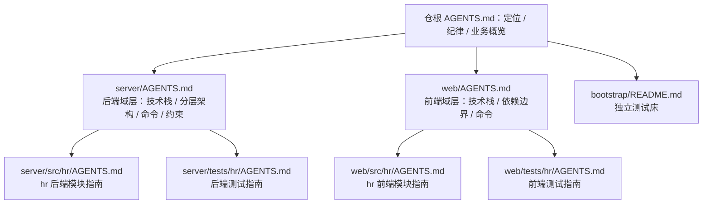

# AGENTS.md

本文件为 Claude Code 在 hr 子仓（kcloudy.hr）中工作时提供指导。

## 仓库定位

HR 业务模块独立子仓，目录体例与主仓（kcloudy.ai-platform）一致：`server/` 后端 + `web/` 前端。通过 git submodule 中性挂载于主仓 `server/python/src/modules/hr`，主仓经三个 git symlink 将内容映射回原路径：

| 主仓路径 | 类型 | 指向（本仓内） |
|----------|------|---------------|
| `server/python/src/hr` | symlink | `modules/hr/server/src/hr` |
| `web/vue/src/hr` | symlink | `../../../server/python/src/modules/hr/web/src/hr` |
| `web/vue/tests/hr` | symlink | `../../../server/python/src/modules/hr/web/tests/hr` |

## 关键纪律

| 纪律 | 说明 |
|------|------|
| 指针同步 | 改本仓必须「先 push 本仓（origin + github 双远端）、再 bump 主仓 gitlink」，禁止只做其一 |
| 依赖管理 | 不自建 pyproject/依赖清单——后端依赖统一主仓 `server/python/pyproject.toml` 依赖组 + `uv.lock`；前端依赖统一主仓 `web/vue/package.json` |
| 开发现场 | 日常开发在主仓挂载点内进行（import/HMR/测试全链零跳转）；本仓同级独立检出用于独立测试床（bootstrap/）与脱离主仓的验证 |
| 提交信息 | 中文，约定式提交（`类型(范围): 描述`） |
| 代码查找 | 优先使用 CodeGraph（`codegraph query/callers/impact/context` 等），避免 grep 扫描；本仓与主仓索引相互独立，跨仓查询切换工作目录 |
| 文档 | Markdown 中文撰写，配图用 Mermaid |

## 业务模块概览

人力资源中心模块，PostgreSQL schema `hr`，声明依赖 `tenant`/`iam`（菜单与权限码经 iam 体系下发，租户上下文来自 tenant 体系）。权限资源与专属动作在 `server/src/hr/module.py` 以 PermissionDef 清单声明，权限码 `hr:{资源}:{动作}`；路由按 `admin`（管理端）/`console`（员工自助）/`inner`（内部接口）三分类。

| 业务域 | 资源 |
|--------|------|
| 员工中心 | 员工（花名册/敏感字段/批量导入）、岗位、异动、合同、材料附件、属性定义（EAV 动态字段） |
| 考勤假期 | 考勤（含考勤导入）、假勤（请假申请/审批） |
| 招聘管理 | 招聘需求、候选人（含合并）、面试、Offer、招聘渠道（归集同步） |
| 薪酬管理 | 薪酬项、职级薪带、定薪、发薪（批次确认/代发文件导出） |
| 绩效管理 | 考核周期、绩效目标、绩效评估（评级校准） |
| 报表分析 | 报表（含导出）、离职风险、自然语言查询 |
| 员工自助 | console 层页面（登录即可见，无权限码） |
| 智能辅助 | AI 助手、Agent 工具集 |

## 文档总览

全仓 AGENTS.md 按「仓根 → 域层（server/web） → 模块/测试层」组织：上级只做索引与规范入口，具体规则写在最贴近代码的一层。

| 文档 | 说明 |
|------|------|
| [server/AGENTS.md](server/AGENTS.md) | 后端域层：技术栈/分层架构/核心命令/开发约束 |
| [server/src/hr/AGENTS.md](server/src/hr/AGENTS.md) | hr 后端模块指南：目录职责/业务域/范式/初始化链 |
| [server/tests/hr/AGENTS.md](server/tests/hr/AGENTS.md) | 后端测试指南：conftest 自适应/测试规则 |
| [web/AGENTS.md](web/AGENTS.md) | 前端域层：技术栈/依赖边界/核心命令 |
| [web/src/hr/AGENTS.md](web/src/hr/AGENTS.md) | hr 前端模块指南：目录职责/取数范式/契约测试 |
| [web/tests/hr/AGENTS.md](web/tests/hr/AGENTS.md) | 前端测试指南：目录结构/运行命令/测试规则 |
| [bootstrap/README.md](bootstrap/README.md) | 独立测试床：隔离基础设施栈 + 一键自举 + 集成/e2e |

主仓侧关联文档（跨仓，文本路径）：`server/python/src/AGENTS.md`（Python 源码层规范）、`web/vue/src/AGENTS.md`（Vue 源码层规范）、`docs/designs/HR前后端子模块化与单容器部署的设计与实施计划.md`（设计依据）。

## 测试

| 层 | 位置 | 运行 |
|----|------|------|
| 后端 unit/integration | `server/tests/hr/`（conftest 布局自适应：主仓工作区或本仓独立检出均可跑） | `python -m pytest server/tests/hr -q`（主仓 venv；integration 触开发库，用例自带清理） |
| 前端 unit | `web/tests/hr/` | 主仓工作区经 symlink：`cd web/vue && pnpm exec vitest run tests/hr` |
| e2e | `web/tests/hr/e2e/`（批 C 新建） | 独立测试床自举环境（docker/） |
| 独立测试床 | `bootstrap/`（批 C 新建） | `bootstrap/bootstrap.sh` 一键自举 |

编写规范与目录结构详见 [server/tests/hr/AGENTS.md](server/tests/hr/AGENTS.md) 与 [web/tests/hr/AGENTS.md](web/tests/hr/AGENTS.md)。

## 打包注意

主仓 hatch wheel `packages` 清单不含 hr（既有事实，Docker COPY 路径不受影响）。若未来 wheel 清单补入 hr，须同步排除挂载点内 `web/` 与 `server/tests/`（防御性要求）。
