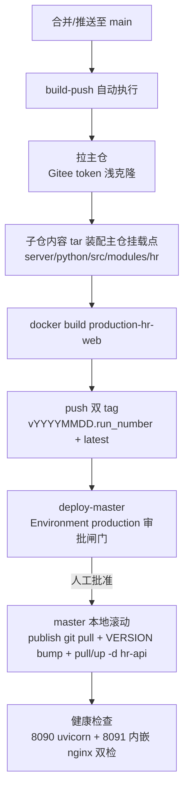

# kcloudy.hr

HR 业务模块独立子仓（AI Platform 的首个业务模块 submodule 试点），目录体例与主仓一致（`server/` 后端 + `web/` 前端），承载 hr 前后端源码与测试。

## 远端

| 远端 | 地址 | 用途 |
|------|------|------|
| origin（主） | git@gitee.com:kenttian/kcloudy.hr.git | 主仓 `.gitmodules` 登记口径 |
| github（镜像） | git@github.com:KentTain/kcloudy.hr.git | 镜像同步，每次提交后双推 |

```bash
git push origin main && git push github main
```

## 目录结构

```text
kcloudy.hr/
├── server/                  # 后端（与主仓体例一致）
│   ├── src/hr/              # Python 包根（controllers/services/models/schemas/
│   │                        #   tasks/listeners/common/integration/migrations）
│   └── tests/hr/            # 后端 unit/integration 测试（conftest 布局自适应）
├── web/                     # 前端（与主仓体例一致）
│   ├── src/hr/              # 前端源码（index.ts api/ pages/ router/ types/ components/ utils/）
│   └── tests/hr/            # 前端 unit 测试 + e2e（批 C）
├── testbed/                 # 独立测试自举（批 C：bootstrap.sh + compose 隔离栈）
├── AGENTS.md                # 开发导航（分层规范/纪律/测试）
├── README.md
└── pytest.ini               # 子仓独立检出时的 pytest 配置
```

## 主仓集成形态

主仓以 submodule 中性挂载本仓于 `server/python/src/modules/hr`，并经三个 git symlink 映射回原路径（import/构建/测试工具链零改动）：

- 后端：`server/python/src/hr -> modules/hr/server/src/hr`（`import hr` 路径不变）
- 前端源码：`web/vue/src/hr -> ../../../server/python/src/modules/hr/web/src/hr`
- 前端测试：`web/vue/tests/hr -> ../../../server/python/src/modules/hr/web/tests/hr`

**开发现场纪律**：日常开发在主仓挂载点内进行；本仓同级独立检出仅用于 testbed 与脱离主仓的验证。修改本仓后必须先双远端推送、再在主仓 bump gitlink。

## 环境要求

| 环境 | 要求 |
|------|------|
| Windows | Developer Mode 开启 + `git config --global core.symlinks true`（clone 时生效；否则三个 symlink 均降级为文本文件，前后端本地开发均不可用） |
| 依赖 | 后端依赖由主仓 `server/python` venv（uv.lock）提供；前端依赖由主仓 `web/vue/node_modules`（pnpm）提供——本仓不自建依赖清单 |

## 测试命令

```bash
# 后端（主仓 venv；主仓工作区内运行或本仓独立检出均可）
python -m pytest server/tests/hr -q

# 前端 unit（主仓工作区内，经 symlink 呈现）
cd web/vue && pnpm exec vitest run tests/hr

# 独立测试床（子仓-only 检出，批 C 交付）
testbed/bootstrap.sh
```

## CI/CD 发布流水线

`.github/workflows/release.yml`（GitHub Actions，self-hosted runner 部署于 master）。

### 流程概览



- **build-push**（自动）：构建上下文为主仓布局——拉主仓（Gitee token）后由子仓内容 tar 装配至挂载点（等价 bootstrap.sh rsync 语义，被测代码由子仓 HEAD 锁定），`docker build --target production-hr-web` 后 push 至阿里云 registry。
- **deploy-master**（人工审批）：批准后于 master 本地执行 publish 编排同步、`.env.node-hr` VERSION bump、`pull` + `up -d hr-api`，健康检查超时（3 分钟）即判失败。

### 前置配置（一次性）

1. **审批环境**：GitHub 仓库 Settings → Environments → 新建 `production`，勾选 Required reviewers 并指定审批人。不配置则 deploy-master 无审批直接执行（等于合并即上生产，严禁）。
2. **Secrets**（Settings → Secrets and variables → Actions）：

| Secret | 值 | 说明 |
|--------|-----|------|
| `GITEE_TOKEN` | Gitee 私人令牌 | 权限仅需 projects 读取；用于拉主仓 |
| `ALIYUN_REGISTRY_USER` | 阿里云 RAM 子账号 | 建议最小权限：仅 `kcloudy-images` namespace 读写，勿用主账号 |
| `ALIYUN_REGISTRY_PASS` | 对应密码 | — |

3. **master 安装 runner**（github.com/actions/runner，linux-x64 包）：

```bash
mkdir -p /opt/actions-runner && cd /opt/actions-runner
tar xzf actions-runner-linux-x64-<版本>.tar.gz
./config.sh --url https://github.com/KentTain/kcloudy.hr --token <仓库 runner token>
./svc.sh install && ./svc.sh start
```

服务用户要求：docker 命令权限（root 或 docker 组）+ `/mnt/docker-images/kcloudy.publish` 写权限。runner 若装在其他节点，deploy-master 的本地执行需改为 SSH（workflow 未含）。

4. **master 本机前置**：docker（BuildKit，Dockerfile cache mount 依赖）、git、tar、阿里云 registry 登录态、publish 仓库在 `/mnt/docker-images/kcloudy.publish`。

### 首次验证

1. 配置完成后，GitHub Actions 页面对之前排队失败的 run 点 **Re-run**（或随便推一个 main 提交）。
2. build-push 通过后，deploy-master 显示 **Waiting for approval** → 审批人在页面点批准。
3. 真机核对：`docker ps` 中 `ai-platform-backend-hr` healthy；`curl http://172.23.160.12:8090/health` 与 `curl -I http://172.23.160.12:8091/` 均 200；hr-api 日志无 nginx 权限报错。

### 日常发布与范围

- 合并至 `main`（PR 合并或直推）即自动触发；每次提交前先双远端推送（见「远端」节）。
- 镜像 tag 规则：`vYYYYMMDD.<run_number>` + `latest`，master `.env.node-hr` 的 `VERSION` 由流水线自动 bump。
- **范围仅 master hr-api 单容器**；worker01/worker02 的 platform 滚动不在流水线内，仍按主仓 `docker/AGENTS.md` 发布指南手动执行。

### 回滚

```bash
cd /mnt/docker-images/kcloudy.publish/deploy
sed -i 's/^VERSION=.*/VERSION=<旧tag>/' .env.node-hr
docker compose -f docker-compose.node-hr.yml --env-file .env.node-hr up -d hr-api
```

registry 旧 tag 永不删除，任意历史版本可回。

### 故障排查

| 现象 | 排查 |
|------|------|
| run 排队不动（No runner matching） | master 上 `./svc.sh status`；服务未启动则 `./svc.sh start` |
| 拉主仓 401/403 | `GITEE_TOKEN` 过期或无 projects 读取权限，重新生成后更新 Secret |
| registry push 403 | RAM 子账号权限不足，检查 kcloudy-images namespace 授权 |
| 构建失败（apt/uv/pnpm 网络抖动） | 直接 Re-run，层缓存可续（与手动构建同口径） |
| 健康检查超时 | master 上 `docker logs ai-platform-backend-hr --tail 100`；日志卷属主（`chown -R 1000:1000 /mnt/kcloudy-data/logs/hr`）与 nginx error_log（`/mnt/kcloudy-data/logs/hr/nginx-error.log`） |
| `git pull --ff-only` 失败 | master publish 仓库有本地改动，先手工处理再 Re-run deploy job |
| runner 磁盘增长 | 构建层缓存累积：master 上 `docker image prune -a -f`（现役镜像受容器引用保护） |
