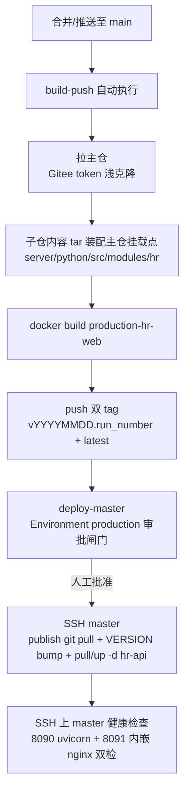

# kcloudy.hr

HR 业务模块独立子仓（AI Platform 的首个业务模块 submodule 试点），目录体例与主仓一致（`server/` 后端 + `web/` 前端），承载 hr 前后端源码与测试。

## 功能概览

人力资源中心业务模块，路由前缀 `/hr`，权限码 `hr:{资源}:{动作}` 随菜单下发：

| 业务域 | 内容 |
|--------|------|
| 员工中心 | 花名册（含敏感字段管控/批量导入）、岗位、异动、合同、材料附件、EAV 动态属性 |
| 考勤假期 | 考勤记录与导入、假期额度、请假申请与审批 |
| 招聘管理 | 招聘需求、候选人（含合并）、面试安排、Offer、渠道归集同步 |
| 薪酬管理 | 薪酬项、职级薪带、定薪、发薪批次（确认/代发文件导出） |
| 绩效管理 | 考核周期、绩效目标、绩效评估与评级校准 |
| 报表分析 | 人力报表与导出、离职风险、自然语言查询 |
| 员工自助 | Console 层自助页面（登录即可见，无权限码） |

## 技术栈

| 层 | 技术 |
|----|------|
| 后端 | Python 3.12 + FastAPI + SQLAlchemy 2.0 + Alembic（模块独立迁移）+ Pydantic |
| 前端 | Vue 3 + TypeScript + Vite + Tailwind CSS 4 + Pinia（shadcn-vue/reka-ui 组件体系，经主仓 framework 封装） |
| 基础设施 | PostgreSQL（模块级 schema 隔离）+ Redis + MinIO |

复用主仓框架能力（模块系统/IAM 通用能力/API 封装/多租户），不自建。

## 远端

| 远端 | 地址 | 用途 |
|------|------|------|
| origin（主） | git@gitee.com:kenttian/kcloudy.hr.git | 主仓 `.gitmodules` 登记口径 |
| github（镜像） | git@github.com:KentTain/kcloudy.hr.git | 镜像同步，每次提交后双推 |

```bash
git push origin main && git push github main
```

## 目录结构

```text
kcloudy.hr/
├── server/                  # 后端（与主仓体例一致）
│   ├── AGENTS.md            # 后端域层指南（技术栈/分层架构/命令/约束）
│   ├── src/hr/              # Python 包根（controllers/services/models/schemas/
│   │                        #   tasks/listeners/common/integration/migrations；含模块层 AGENTS.md）
│   └── tests/hr/            # 后端 unit/integration 测试（conftest 布局自适应；含测试层 AGENTS.md）
├── web/                     # 前端（与主仓体例一致）
│   ├── AGENTS.md            # 前端域层指南（技术栈/依赖边界/命令）
│   ├── src/hr/              # 前端源码（index.ts api/ pages/ router/ types/ components/ utils/；含模块层 AGENTS.md）
│   └── tests/hr/            # 前端 unit 测试 + e2e（批 C；含测试层 AGENTS.md）
├── bootstrap/               # 独立测试自举（批 C：bootstrap.sh + compose 隔离栈）
├── AGENTS.md                # 仓根开发导航（纪律/业务概览/文档总览）
├── README.md
└── pytest.ini               # 子仓独立检出时的 pytest 配置
```

## 主仓集成形态

主仓以 submodule 中性挂载本仓于 `server/python/src/modules/hr`，并经三个 git symlink 映射回原路径（import/构建/测试工具链零改动）：

- 后端：`server/python/src/hr -> modules/hr/server/src/hr`（`import hr` 路径不变）
- 前端源码：`web/vue/src/hr -> ../../../server/python/src/modules/hr/web/src/hr`
- 前端测试：`web/vue/tests/hr -> ../../../server/python/src/modules/hr/web/tests/hr`

**开发现场纪律**：日常开发在主仓挂载点内进行；本仓同级独立检出仅用于独立测试床（bootstrap/）与脱离主仓的验证。修改本仓后必须先双远端推送、再在主仓 bump gitlink。

## 快速开始

日常开发在主仓工作区内进行（hr 经 symlink 映射，import/HMR/测试全链零跳转）：

```bash
# 1. 克隆主仓并检出子模块（Windows 需 Developer Mode + core.symlinks，见「环境要求」）
git clone git@gitee.com:kenttian/kcloudy.ai-platform.git
cd kcloudy.ai-platform
git submodule update --init server/python/src/modules/hr

# 2. 后端：安装依赖、配置、启动（hr 模块随主仓应用动态加载，启动期同步菜单/权限码）
cd server/python
uv sync
cp config/application-local.yml.example config/application-local.yml
uv run python manage.py runserver

# 3. 前端：安装依赖、启动
cd web/vue
pnpm install
pnpm dev
```

访问 <http://localhost:5173>（后端 API 文档 <http://localhost:8000/docs>），登录后侧边栏进入人力资源菜单。

脱离主仓的独立验证（子仓-only 检出、隔离基础设施栈、集成/e2e 测试）见 [bootstrap/README.md](bootstrap/README.md)。

## 环境要求

| 环境 | 要求 |
|------|------|
| Windows | Developer Mode 开启 + `git config --global core.symlinks true`（clone 时生效；否则三个 symlink 均降级为文本文件，前后端本地开发均不可用） |
| 依赖 | 后端依赖由主仓 `server/python` venv（uv.lock）提供；前端依赖由主仓 `web/vue/node_modules`（pnpm）提供——本仓不自建依赖清单 |

## 测试命令

```bash
# 后端（主仓 venv；主仓工作区内运行或本仓独立检出均可）
python -m pytest server/tests/hr -q

# 前端 unit（主仓工作区内，经 symlink 呈现）
cd web/vue && pnpm exec vitest run tests/hr

# 独立测试床（子仓-only 检出，批 C 交付）
bootstrap/bootstrap.sh
```

## 文档导航

全仓 AGENTS.md 按「仓根 → 域层 → 模块/测试层」分层组织（上级只做索引，规则贴代码层），完整索引见根 [AGENTS.md「文档总览」](AGENTS.md#文档总览)：

| 文档 | 说明 |
|------|------|
| [AGENTS.md](AGENTS.md) | 仓根导航：关键纪律/业务概览/文档总览/测试/打包 |
| [server/AGENTS.md](server/AGENTS.md) | 后端域层：技术栈/分层架构/核心命令/开发约束 |
| [server/src/hr/AGENTS.md](server/src/hr/AGENTS.md) | hr 后端模块指南：目录职责/业务域/范式/初始化链 |
| [server/tests/hr/AGENTS.md](server/tests/hr/AGENTS.md) | 后端测试指南：conftest 自适应/测试规则 |
| [web/AGENTS.md](web/AGENTS.md) | 前端域层：技术栈/依赖边界/核心命令 |
| [web/src/hr/AGENTS.md](web/src/hr/AGENTS.md) | hr 前端模块指南：目录职责/取数范式/契约测试 |
| [web/tests/hr/AGENTS.md](web/tests/hr/AGENTS.md) | 前端测试指南：目录结构/运行命令/测试规则 |
| [bootstrap/README.md](bootstrap/README.md) | 独立测试床：一键自举 + 集成/e2e 测试 |
| 主仓 `docs/designs/HR前后端子模块化与单容器部署的设计与实施计划.md` | 子模块化与单容器部署设计依据 |

## 发布方式（CI/CD）

hr 全合一镜像发布共四种方式：方式一已落地，方式二/三/四为备选（未实施，启用前需按各自说明补配置）。worker01/worker02 的 platform 滚动均不在四种方式范围内，仍按主仓 `docker/AGENTS.md` 发布指南手动执行。

| | 方式一：GitHub Actions 托管 runner（**现行**） | 方式二：GitHub Actions self-hosted | 方式三：Gitee Go | 方式四：Gitee webhook 自建 |
|---|---|---|---|---|
| 触发入口 | GitHub 侧 main（双推同步到达） | GitHub 侧 main（同左） | Gitee 侧 main | Gitee 侧 main |
| 执行环境 | GitHub 托管 ubuntu-latest（境外，公网拉推） | self-hosted runner（master，内网拉推 registry） | Gitee 托管云构建节点（公网拉推） | master 本机触发器脚本 |
| 滚动执行 | SSH 到 master（密钥 Secret + 受限账号） | master 本地（runner 与 master 同机，零 SSH） | Gitee 主机组 SSH | 无现成 UI，滚动段退化为人工执行 |
| 审批闸门 | Environment `production` Required reviewers（现成 UI） | 同左（机制不变） | 流水线人工审核插件 | 无现成 UI |
| 日志/重试 | Actions 页面全现成 | Actions 页面全现成 | Gitee 流水线页面 | master 本地日志文件，简陋 |
| 单次耗时 | 20-40 分钟（境外拉基础镜像+push 回 ~1-2GB） | 10-20 分钟（内网） | 10-20 分钟 | 10-20 分钟（内网） |
| 费用 | 私有仓 2000 分钟/月免费（Linux 1x 倍率），单次 20-40 分钟 ≈ 50-100 次/月 | 私有仓 2000 分钟/月免费额度内（self-hosted 0 倍率计费） | 每仓 200 分钟永久 + 每月 500 分钟，超出预付费 | 零额度 |
| 运维面 | 零安装零运维 | master 装 runner 服务（一次） | 零运维（平台托管） | 自维护触发器服务+脚本 |
| 选型定位 | 默认方案（零运维；接受境外网络耗时与 SSH 密钥入 Secret） | 发布高频或对耗时敏感、不愿 SSH 私钥入 Secret | 想留在 Gitee 生态且月度发布次数少 | 额度焦虑或需完全自主可控 |

### 方式一：GitHub Actions 托管 runner（现行）

`.github/workflows/release.yml`（GitHub 托管 ubuntu-latest runner，与主仓 platform 侧流水线同构）。

### 流程概览



- **build-push**（自动）：构建上下文为主仓布局——拉主仓（Gitee token）后由子仓内容 tar 装配至挂载点（等价 bootstrap.sh rsync 语义，被测代码由子仓 HEAD 锁定），`docker build --target production-hr-web` 后 push 至阿里云 registry。
- **deploy-master**（人工审批）：批准后经 SSH 在 master 上执行 publish 编排同步、`.env.node-hr` VERSION bump、`pull` + `up -d hr-api`，健康检查（SSH 上 master curl 双检）超时（3 分钟）即判失败。

### 前置配置（一次性）

1. **审批环境**：GitHub 仓库 Settings → Environments → 新建 `production`，勾选 Required reviewers 并指定审批人。不配置则 deploy-master 无审批直接执行（等于合并即上生产，严禁）。
2. **Secrets**（Settings → Secrets and variables → Actions）：

| Secret | 值 | 说明 |
|--------|-----|------|
| `GITEE_TOKEN` | Gitee 私人令牌 | 权限仅需 projects 读取；用于拉主仓 |
| `ALIYUN_REGISTRY_USER` | 阿里云 RAM 子账号 | 建议最小权限：仅 `kcloudy-images` namespace 读写，勿用主账号 |
| `ALIYUN_REGISTRY_PASS` | 对应密码 | — |
| `SSH_PRIVATE_KEY` | master 部署私钥 | **专用受限账号，勿 root**；仅放行 publish 目录与 docker 命令 |
| `SSH_USER` | SSH 用户名 | 与上配套 |

3. **known_hosts**：首跑经 `StrictHostKeyChecking=accept-new` TOFU 自动落册，无需预配。

### 首次验证

1. 配置完成后，GitHub Actions 页面对之前排队失败的 run 点 **Re-run**（或随便推一个 main 提交）。
2. build-push 通过后，deploy-master 显示 **Waiting for approval** → 审批人在页面点批准。
3. 真机核对：`docker ps` 中 `ai-platform-backend-hr` healthy；`curl http://172.23.160.12:8090/health` 与 `curl -I http://172.23.160.12:8091/` 均 200；hr-api 日志无 nginx 权限报错。

### 日常发布与范围

- 合并至 `main`（PR 合并或直推）即自动触发；每次提交前先双远端推送（见「远端」节）。
- 镜像 tag 规则：`vYYYYMMDD.<run_number>` + `latest`，master `.env.node-hr` 的 `VERSION` 由流水线自动 bump。
- **范围仅 master hr-api 单容器**；worker01/worker02 的 platform 滚动不在流水线内，由主仓流水线独立承载（详见主仓 `docs/README.md`「四、自动化发布」）。

### 回滚

```bash
cd /mnt/docker-images/kcloudy.publish/deploy
sed -i 's/^VERSION=.*/VERSION=<旧tag>/' .env.node-hr
docker compose -f docker-compose.node-hr.yml --env-file .env.node-hr up -d hr-api
```

registry 旧 tag 永不删除，任意历史版本可回。

### 故障排查

| 现象 | 排查 |
|------|------|
| 拉主仓 401/403 | `GITEE_TOKEN` 过期或无 projects 读取权限，重新生成后更新 Secret |
| registry push 403 | RAM 子账号权限不足，检查 kcloudy-images namespace 授权 |
| 构建失败（apt/uv/pnpm 网络抖动） | 直接 Re-run，层缓存可续（与手动构建同口径） |
| SSH 连接失败 | `SSH_PRIVATE_KEY`/`SSH_USER` Secret 核对；master 安全组放行 runner 出口；账号非 root 时确认 docker 命令权限 |
| 健康检查超时 | SSH 上 master `docker logs ai-platform-backend-hr --tail 100`；日志卷属主（`chown -R 1000:1000 /mnt/kcloudy-data/logs/hr`）与 nginx error_log（`/mnt/kcloudy-data/logs/hr/nginx-error.log`） |
| `git pull --ff-only` 失败 | master publish 仓库有本地改动，先手工处理再 Re-run deploy job |

### 方式二：GitHub Actions self-hosted runner（备选，未实施）

与方式一共用同一份 `release.yml` 结构，仅三处差异，切换成本最低：

1. **runs-on 改自托管**：`build-push` 与 `deploy-master` 两 job 的 `runs-on: ubuntu-latest` 改为 `runs-on: [self-hosted]`。
2. **deploy-master 改本地执行**：runner 装在 master 上则滚动免 SSH——deploy-master 的滚动与健康检查步骤去掉 ssh 包装直接本地执行，Secrets 仅需三件（`GITEE_TOKEN`、`ALIYUN_REGISTRY_USER/PASS`）。
3. **master 安装 runner**（github.com/actions/runner，linux-x64 包）：

```bash
mkdir -p /opt/actions-runner && cd /opt/actions-runner
tar xzf actions-runner-linux-x64-<版本>.tar.gz
./config.sh --url https://github.com/KentTain/kcloudy.hr --token <仓库 runner token>
./svc.sh install && ./svc.sh start
```

   服务用户要求：docker 命令权限（root 或 docker 组）+ `/mnt/docker-images/kcloudy.publish` 写权限 + BuildKit（Dockerfile cache mount 依赖）。

代价与收益：

- 收益：内网拉推 registry 快（单次 10-20 分钟）、滚动零 SSH（免 SSH 私钥入 Secret）、self-hosted 0 倍率计费不耗额度。
- 代价：master 常驻 runner 服务需维护（升级/掉线巡检），构建层缓存占用 master 磁盘（定期 `docker image prune -a -f`）。

### 方式三：Gitee Go（备选，未实施）

Gitee 原生流水线，托管云构建节点执行（无 self-hosted runner 对等机制，自建执行需接 Jenkins/K8s 或自定义插件，不在本方案考虑内）。

1. **开通**：Gitee 仓库页「流水线」开通 Gitee Go，仓库根新建 `.workflow/release.yml`（Gitee Go 语法，与 GitHub Actions 语法不兼容，需按官方 plugin 体系改写）。
2. **凭据**：构建环境变量登记 Gitee 令牌（拉主仓）与阿里云 registry 账号密码（流水线配置页环境变量，勾选加密）。
3. **构建步骤**：与方式一 build-push 逻辑相同——拉主仓 → tar 装配挂载点 → `docker build --target production-hr-web` → push 双 tag。云构建节点自带 docker，构建时长 10-20 分钟/次。
4. **滚动步骤**：Gitee Go 部署插件（主机组功能）配 master 主机 + SSH 凭据，执行与方式一 deploy-master 相同的 publish 同步 + VERSION bump + pull/up + 健康检查；人工审核插件放在部署步骤前作为闸门。
5. **计费约束**：每仓 200 分钟永久 + 每月 500 分钟免费，超出按构建时长预付费。10-20 分钟/次 ≈ 每月 15-25 次，低频发布够用。

注意：云构建节点在境外或境内机房以 Gitee 实际分配为准，拉推阿里云 registry 走公网，速度与方式一托管 runner 相当，劣于方式二 self-hosted 的 master 内网。

### 方式四：Gitee webhook + master 自建触发器（备选，未实施）

不走任何 CI 平台：Gitee 仓库 Push webhook 直接触发 master 本机脚本，零额度、内网拉推、贴合 Gitee 主推流程；代价是无现成审批/日志 UI，可维护性靠脚本质量。

1. **Gitee webhook**：仓库管理 → WebHooks → 新增，URL 指向 master 触发器服务端口，勾选 Push 事件，设 webHook 密码（触发器校验签名防伪造触发）。
2. **触发器服务**（master，systemd 常驻，Python 标准库即可）：

```python
#!/usr/bin/env python3
# /opt/hr-release/listener.py —— Gitee webhook 触发器骨架（仅构建推送，滚动人工）
import hmac, subprocess
from hashlib import sha256
from http.server import HTTPServer, BaseHTTPRequestHandler

SECRET = b"<webhook 密码>"
SCRIPT = "/opt/hr-release/build-push.sh"   # 逻辑=release.yml build-push job 翻译成 shell

class H(HTTPServer, BaseHTTPRequestHandler):
    def do_post(self):
        body = self.rfile.read(int(self.headers["Content-Length"]))
        sig = hmac.new(SECRET, body, sha256).hexdigest()
        # Gitee 签名头 X-Gitee-Token（sha256 hmac）；校验失败即拒
        if not hmac.compare_digest(sig, self.headers.get("X-Gitee-Token", "")):
            self.send_response(403); self.end_headers(); return
        payload = __import__("json").loads(body)
        if payload.get("ref") == "refs/heads/main":
            subprocess.Popen(["bash", SCRIPT])   # 异步执行，立即响应避免 webhook 超时
        self.send_response(200); self.end_headers()

HTTPServer(("127.0.0.1", 18099), H).serve_forever()
```

仅监听 127.0.0.1，经 master 宿主 nginx 反代暴露（server_name 专用子域或路径 + 密码校验双保险），不直接暴露公网端口。

3. **systemd unit**：`/etc/systemd/system/hr-release-listener.service`（ExecStart 上述脚本，Restart=always），`systemctl enable --now`。
4. **build-push.sh**：翻译 release.yml 的 build-push job——checkout/装配（tar 管道）→ `docker build` → `docker push`，输出 tag 落 `/opt/hr-release/last-tag` 供人工滚动参考。
5. **滚动保持人工**：无审批 UI，滚动不进脚本——构建完成后按主仓发布指南 master 段手动执行（或临时 `sed` VERSION 后 `up -d hr-api`），与「先构建后择机滚动」的节奏天然契合。

## License

Copyright © 2025 Moles. All Rights Reserved.
